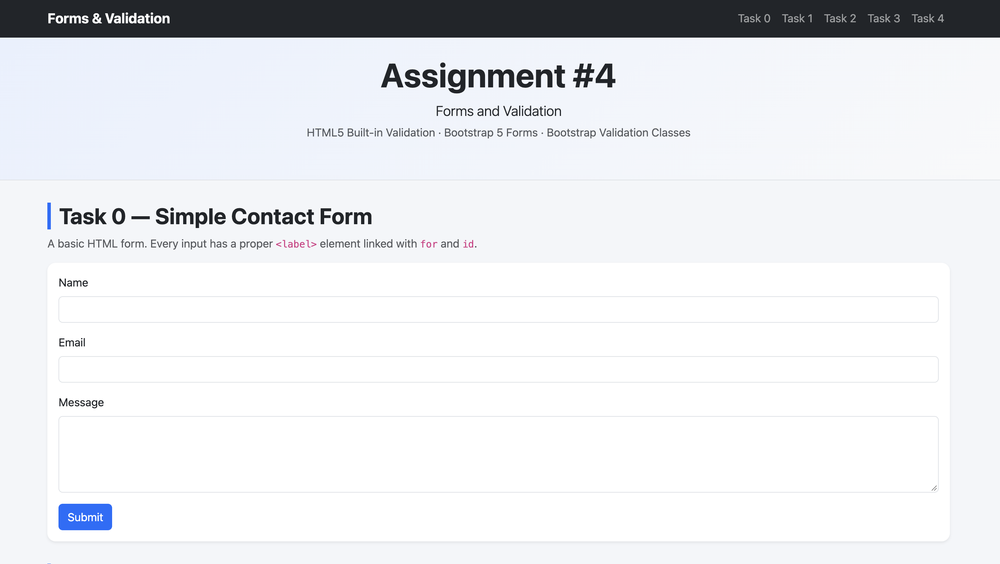
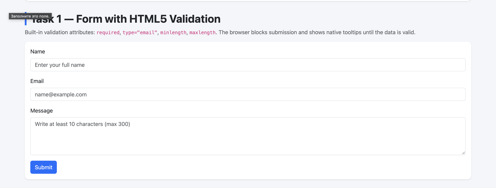
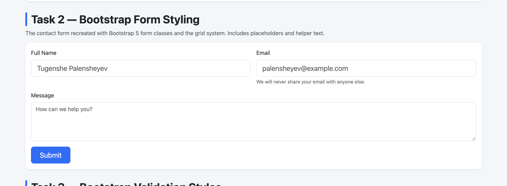
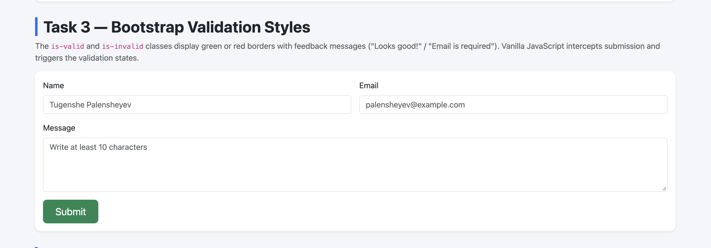
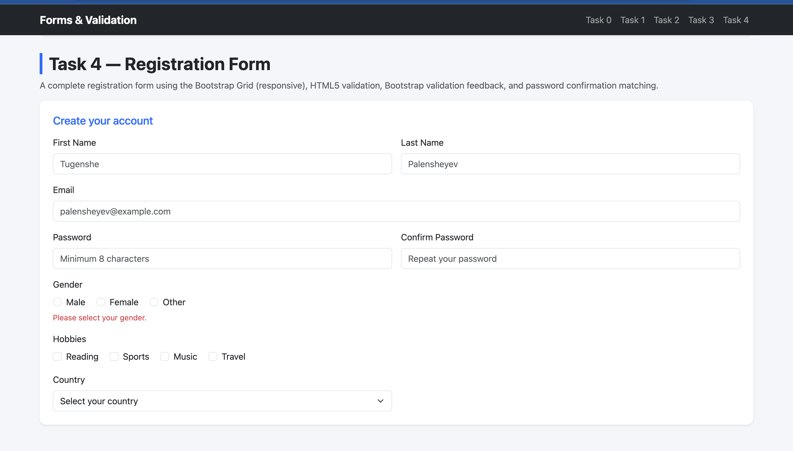

# Assignment #4 — Forms and Validation

## Student Information

- **University:** Astana IT University
- **Group:** IT-2513
- **Name:** Assylkhan Sansyzbay

## Project Description

This project demonstrates the creation of user-friendly HTML forms styled with Bootstrap 5 form components, together with two validation approaches: HTML5 built-in validation (attributes such as `required`, `type="email"`, `minlength`, `maxlength`) and Bootstrap validation feedback classes (`is-valid`, `is-invalid`, `valid-feedback`, `invalid-feedback`).

## Technologies Used

- HTML5
- CSS3
- Bootstrap 5.3
- Vanilla JavaScript

## Tasks

### Task 0 — Simple Contact Form

A basic contact form with Name (text input), Email (email input), Message (textarea) and a Submit button. Every field has a proper `&lt;label&gt;` element linked to its input using the `for` and `id` attributes.

### Task 1 — Form with HTML5 Validation

The contact form extended with built-in HTML5 validation attributes (`required`, `type="email"`, `minlength`, `maxlength`). The browser enforces validation automatically and blocks submission of empty or invalid data.

### Task 2 — Bootstrap Form Styling

The contact form recreated using Bootstrap 5 form classes (`form-control`, `form-label`, `form-text`). The Bootstrap grid system (`row`, `col-md-6`, `g-3`) arranges the fields neatly, with placeholders and helper text.

### Task 3 — Bootstrap Validation Styles

The Bootstrap form enhanced with `is-valid` / `is-invalid` classes and feedback messages below the inputs ("Looks good!" / "Email is required"). A minimal vanilla JavaScript snippet intercepts the form submission, calls `checkValidity()` and adds the `was-validated` class to trigger the visual validation states.

### Task 4 — Registration Form

A complete registration form with First Name, Last Name, Email, Password, Confirm Password, Gender (radio buttons), Hobbies (checkboxes) and Country (select dropdown), plus Submit and Reset buttons. The form is fully responsive thanks to the Bootstrap Grid. It combines HTML5 validation (for example, a minimum password length of 8 characters) with Bootstrap validation feedback, and custom JavaScript ensures the password confirmation matches the original password.

## Work Process Summary

I started by building a plain HTML contact form, making sure every input had a correctly linked label element. Next, I added HTML5 validation attributes and tested how the browser enforces rules such as required fields, correct email format and character limits.

After that, I recreated the form with Bootstrap 5 classes, using the grid system to arrange the fields and adding placeholders and helper text for a better user experience. I then applied Bootstrap validation feedback classes together with a small vanilla JavaScript script that intercepts form submission and applies the `was-validated` class, producing clear error and success messages.

Finally, I developed the registration form, combining all the techniques: a responsive Bootstrap Grid layout, HTML5 validation, Bootstrap feedback messages, radio buttons, checkboxes, a select dropdown, and custom JavaScript for password confirmation matching.

## How to Run

1. Open `index.html` in any modern browser, or
2. Use a local server: `python3 -m http.server 8000` and visit `http://localhost:8000`